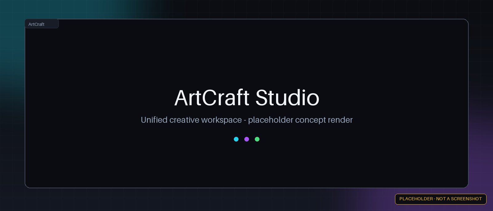
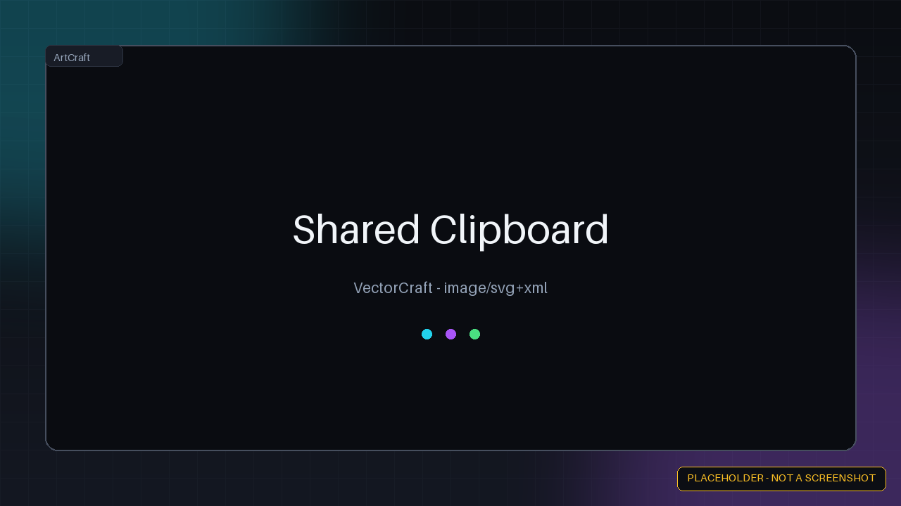
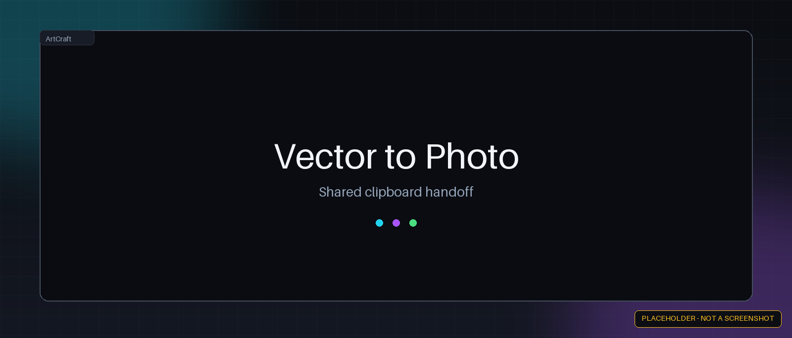
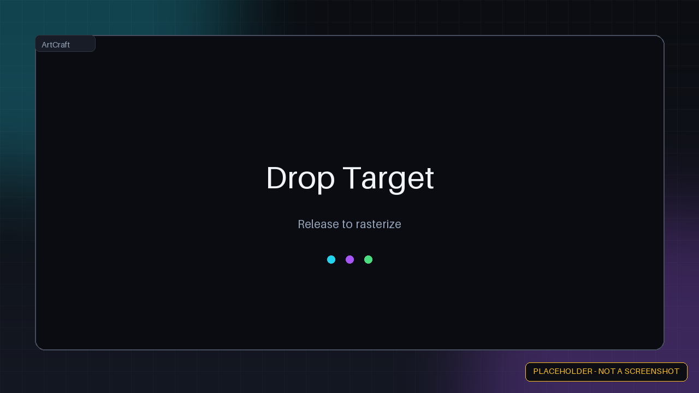
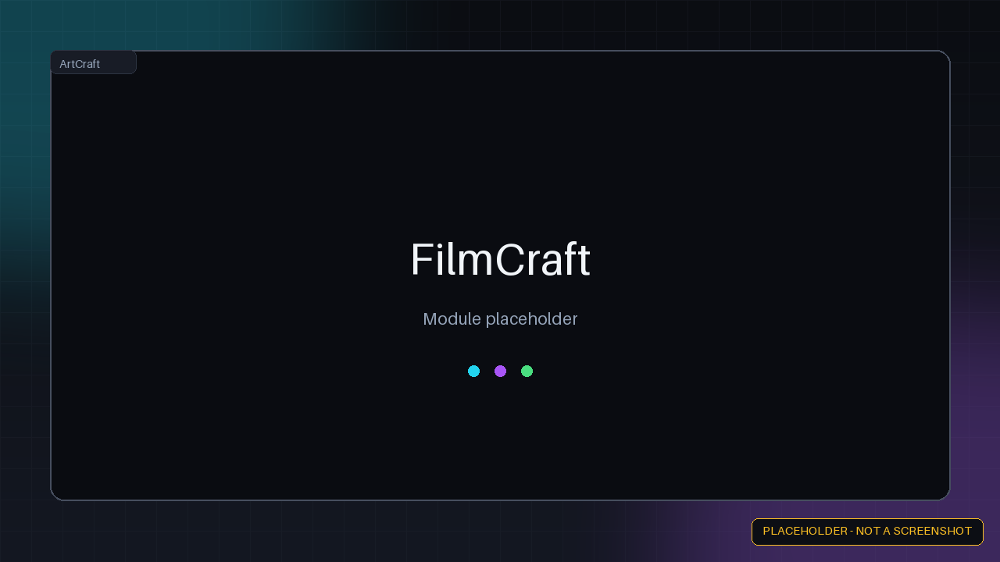
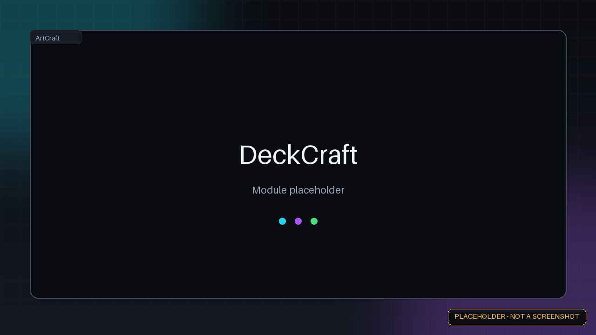

# 🎨 ArtCraft Studio

**A unified desktop shell for ten creative modules**

ArtCraft Studio is a Rust + Tauri 2.0 monorepo that registers ten creative modules behind a shared `CraftModule` trait and hosts them in one desktop process. It is an early-stage proof of concept: the shell, module registry, shared clipboard and two asset pipelines are implemented; the other eight modules are UI placeholders.

> **Status:** proof of concept. PhotoCraft's SVG → PNG rasterizer and VectorCraft's SVG export to the shared clipboard work. FilmCraft, WordCraft, DeckCraft, DesignCraft, EffectCraft, LightCraft, GridCraft and PDFCraft currently render placeholder editors; their actions return success without modifying anything. See [audit.md](audit.md) for the current known issues.

## 🌟 The ten modules

| Module | Domain | Current state |
| :--- | :--- | :--- |
| **PhotoCraft** | Raster editing | **Implemented:** `rasterize_svg` decodes a Base64 SVG and renders it to PNG with `usvg` + `tiny-skia` + `resvg` |
| **VectorCraft** | Vector graphics | **Implemented:** `export_svg` writes an SVG into the shared clipboard |
| **FilmCraft** | Video editing | Placeholder editor; `add_clip`, `split_clip`, `render_timeline` are stubs |
| **WordCraft** | Word processing | Placeholder editor; `insert_text`, `apply_style`, `export_pdf` are stubs |
| **DeckCraft** | Presentations | Placeholder editor; `add_slide`, `apply_theme`, `start_presentation` are stubs |
| **DesignCraft** | Page layout | Placeholder editor; `create_grid`, `place_text_frame`, `export_print_ready` are stubs |
| **EffectCraft** | Motion graphics | Placeholder editor; `add_compositor_node`, `set_keyframe`, `render_frame` are stubs |
| **LightCraft** | RAW editing | Placeholder editor; `adjust_white_balance`, `apply_tone_curve`, `sync_edits` are stubs |
| **GridCraft** | Spreadsheets | Placeholder grid; `add_row`, `apply_formula`, `export_csv` are stubs |
| **PDFCraft** | PDF tools | Placeholder viewer; `merge_pdfs`, `split_pdf`, `add_watermark` are stubs |

## ✅ What works today

- **One process, ten modules.** Modules implement the `CraftModule` trait and are registered in a `ModuleRegistry`; the shell invokes their actions through Tauri commands.
- **Capability-driven toolbar.** Each module declares its actions, and the frontend renders the toolbar from that list.
- **Shared clipboard state.** A `SharedState` clipboard holds a Base64 payload with its source module and MIME type, exposed through `get_clipboard` / `set_clipboard`.
- **SVG → PNG pipeline.** Dropping onto the PhotoCraft canvas rasterizes the clipboard's SVG and displays the PNG.
- **Ten module tabs** with placeholder editors for the modules that are not implemented yet.

The clipboard is an in-process `RwLock<Option<ClipboardItem>>`; payloads are Base64-encoded and copied across Tauri IPC. It is not shared memory and it is not zero-copy. VectorCraft's export currently writes clipboard state without emitting the `clipboard-updated` event, so the left sidebar does not refresh until another module sets it.

## 🚀 Quick start

Requires **Rust stable**, **Node.js 20+**, and the **Tauri 2 CLI**. `just` is optional.

```bash
# 1. Clone the repository
git clone https://github.com/dev-justin-time/artdesktop.git
cd artdesktop

# 2. Install frontend dependencies (Node.js 20+)
cd crates/craft-studio-shell/ui && npm ci && cd ../../..

# 3. Install the Tauri CLI once
cargo install tauri-cli --version "^2"

# 4. Run in development mode
just dev
```

Without `just`:

```bash
cd crates/craft-studio-shell
cargo tauri dev
```

Build the release workspace (the frontend must be built first):

```bash
cd crates/craft-studio-shell/ui && npm run build && cd ../../..
cargo build --release --workspace
```

No installer/bundler configuration exists yet; the release build produces the binary but not packaged installers.

## 🏗️ Architecture

- **`crates/craft-libs`** — the `CraftModule` trait, `ModuleAction` capabilities, `ModuleRegistry`, and `SharedState` (clipboard).
- **`crates/craft-studio-shell`** — the Tauri 2 application, its commands, `tauri.conf.json`, and the Vite + TypeScript frontend in `ui/`.
- **`apps/*`** — one crate per creative module, each implementing `CraftModule`.

## 🛡️ CI

`.github/workflows/ci.yml` runs on every push and pull request to `main`:

- `npm ci` and `npm run build` (frontend)
- `cargo fmt --all -- --check`
- `cargo clippy --workspace --all-targets -- -D warnings`
- `cargo test --workspace` (there are currently no test cases)
- `cargo build --release --workspace`

The same sequence is available locally through `just ci`.

## 🖼️ Screenshots

> **Placeholder images:** every image below is a generated placeholder, not a screenshot of the running app. Replace them with real captures as the modules land.

<p align="center">
  
</p>

| Unified shell | Shared clipboard | SVG → PNG |
|:---:|:---:|:---:|
|  |  |  |
| Ten modules, one process | Base64 payload in `SharedState` | Rendered in pure Rust |

| Vector → Photo | Drop target |
|:---:|:---:|
|  |  |
| Export SVG, then rasterize in PhotoCraft | PhotoCraft accepts a dropped SVG |

<details>
<summary>🎛️ Module placeholders (expand)</summary>

| Module | Preview |
|---|---|
| PhotoCraft |  |
| VectorCraft |  |
| FilmCraft |  |
| WordCraft |  |
| DeckCraft |  |
| EffectCraft |  |
| LightCraft |  |
| DesignCraft |  |

</details>

## 🤝 Contributing

The module boundary is the `CraftModule` trait in `crates/craft-libs/src/lib.rs`: implement `id`, `name`, `capabilities` and `handle_action`, then register the module in `crates/craft-studio-shell/src/main.rs`. See [audit.md](audit.md) for the open work items.

## 📜 License

Licensed under the [Apache License, Version 2.0](LICENSE).
